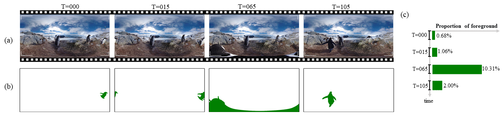

# [ECCV 2024] PanoVOS: Bridging Non-panoramic and Panoramic Views with Transformer for Video Segmentation

**[🏠[Homepage]](https://shilinyan99.github.io/PanoVOS/)** &emsp; **[📄[ECCV 2024]](https://doi.org/10.1007/978-3-031-72673-6_19)** &emsp; **[📄[arXiv]](https://arxiv.org/abs/2309.12303)**


PanoVOS is the first benchmark for panoramic video object segmentation. 



## News
***[🔥🔥🔥 Full validation & test ground-truth annotations and the official local evaluation toolkit are now released in this repository!]***

***[🔥🔥🔥01.07.2024: PanoVOS has been accepted by ECCV 2024!]***

***[🔥🔥🔥28.09.2023: Dataset has been released!]***


## Dataset

***[🔥🔥🔥22.09.2023: Dataset has been released!]***

⬇️ Get the dataset from: 

 - ☁️ [Google Drive](https://drive.google.com/drive/folders/18dki-y3bTdoLcoJgdvKmaiqcqlUfBgyA?usp=drive_link) (`train.zip`, `valid.zip`, `test.zip` RGB frames)
 - 📦 [Validation Full GT Annotations (`val_annotations.zip`, 10 MB)](./annotations/val_annotations.zip)
 - 📦 [Test Full GT Annotations (`test_annotations.zip`, 12 MB)](./annotations/test_annotations.zip)


🤗 Or use [gdown](https://github.com/wkentaro/gdown):

 ```bash
 🎉 train.zip 5.88 GB
  gdown 'https://drive.google.com/uc?id=178E1TYK7tgj-FXzgnjJyx9gZs2GhQBqr'
🎆 valid.zip 3.5 GB
  gdown 'https://drive.google.com/uc?id=10P49VBM7vhGHCqhYvaIjzs7wV0oKLGNl'
📌 test.zip 3.21 GB
  gdown 'https://drive.google.com/uc?id=1dOiJ55rDP82Fdvm32OYuh1RGMCdHxCMe'
 ```

### File Structure
The dataset follows a similar structure as [DAVIS](https://davischallenge.org/) and [Youtube-VOS](https://youtube-vos.org/). The dataset consists of two parts: `JPEGImages` which holds the frame images, and `Annotations` which contains the corresponding segmentation masks. 

While `train.zip` includes annotations for all frames, `valid.zip` and `test.zip` on Google Drive only include 1st-frame query masks for inference. **Full-frame ground-truth annotations, metadata, and seen/unseen splits** for both `val` and `test` are directly provided in [`annotations/`](./annotations):

- [`annotations/val_annotations.zip`](./annotations/val_annotations.zip) (11 MB — 35 validation sequences, `val_meta.json`, `val_unseen.txt`)
- [`annotations/test_annotations.zip`](./annotations/test_annotations.zip) (12 MB — 35 test sequences, `test_meta.json`, `test_unseen.txt`)

To unpack full-frame ground-truth annotations into your dataset directory (optional if only running evaluation, as the evaluation script auto-extracts them on first run):

```bash
unzip -o annotations/val_annotations.zip -d /path/to/PanoVOS/val
unzip -o annotations/test_annotations.zip -d /path/to/PanoVOS/test
```

```
{PanoVOS ROOT}
|-- train
    |-- JPEGImages
        |-- video1
            |-- 00000.jpg
            |-- ...
    |-- Annotations
        |-- video1
            |-- 00000.png
            |-- ...
    |-- train_meta.json
|-- val
    |-- ...
|-- test
    |-- ...


x_meta.json
    {
        "videos": {
            "<video_id>": {
                "objects": {
                    "<object_id>": {
                        "frame_range": {
                            "start": <start_frame>,
                            "end": <end_frame>,
                            "frame_nums": <frame_nums>
                        }
                    }
                }
            }
        }
    }

# <object_id> is the same as the pixel values of object in annotated segmentation PNG files.
# <frame_id> is the 5-digit index of frame in video, and not necessary to start from 0.
# <start_frame> is the  start frame id of target object.
# <end_frame> is the  end frame id of target object.
# <frame_nums> is the number of existing frames of target object.

```


## Evaluation

Since the legacy CodaLab server has been sunset, we release the official evaluation toolkit (100% aligned with the CodaLab scoring program and ECCV 2024 benchmark) for fast local evaluation on both **Validation** and **Test** sets.

### 1. Dependencies

```bash
pip install -r evaluation/requirements.txt
```

### 2. Prediction Format

Save predicted indexed PNG masks (at 6 fps, matching frame IDs and object pixel IDs in `val_meta.json` / `test_meta.json`) under each sequence folder:

```
<results_path>/
|-- <video_id_1>/
    |-- 00000.png
    |-- 00005.png
    |-- ...
|-- <video_id_2>/
    |-- ...
```

> CodaLab-style `<results_path>/Annotations/<video_id>/<frame_id>.png` directories and `.zip` submission archives are also supported directly.

### 3. Run Local Evaluation

Run directly from the cloned repository (the bundled ground-truth archives under `annotations/` are extracted automatically on first run):

```bash
# Validation set
python evaluation/evaluation_method.py --set val --results_path /path/to/val_predictions --mp_nums 8

# Test set
python evaluation/evaluation_method.py --set test --results_path /path/to/test_predictions --mp_nums 8
```

Optional arguments:
- `--PanoVOS_path /path/to/PanoVOS`: custom dataset root or subset folder (if omitted, uses `annotations/{val,test}_annotations.zip`).
- `--output_path /path/to/save_csv`: custom directory for `global_results-{set}.csv` and `per-sequence_results-{set}.csv`.
- `--recompute`: force re-evaluation even if result CSVs already exist.

### 4. Metrics

Following DAVIS and YouTube-VOS, we report Region Jaccard ($\mathcal{J}$) and Boundary F-measure ($\mathcal{F}$) across seen and unseen categories:
- `J-seen-Mean`, `F-seen-Mean`: mean $\mathcal{J}$ and $\mathcal{F}$ on seen categories (25 sequences per split)
- `J-unseen-Mean`, `F-unseen-Mean`: mean $\mathcal{J}$ and $\mathcal{F}$ on unseen categories (10 sequences per split)
- `J-Mean`, `F-Mean`: average of seen and unseen $\mathcal{J}$ / $\mathcal{F}$
- `J&F-Mean` (`Overall`): $\frac{1}{4}(\mathcal{J}_{\text{seen}} + \mathcal{F}_{\text{seen}} + \mathcal{J}_{\text{unseen}} + \mathcal{F}_{\text{unseen}})$


## Citation
Please consider to cite PanoVOS if it helps your research.

```bibtex
@inproceedings{yan2024panovos,
  title={PanoVOS: Bridging Non-panoramic and Panoramic Views with Transformer for Video Segmentation},
  author={Yan, Shilin and Xu, Xiaohao and Zhang, Renrui and Hong, Lingyi and Chen, Wenchao and Zhang, Wenqiang and Zhang, Wei},
  booktitle={European Conference on Computer Vision (ECCV)},
  pages={346--365},
  year={2024},
  publisher={Springer}
}
```

## Contact
If you have any question about this project, please feel free to contact tattoo.ysl@gmail.com.

## License
PanoVOS is licensed under a [CC BY-NC-SA 4.0](https://creativecommons.org/licenses/by-nc-sa/4.0/) License. The data of PanoVOS is released for <strong>non-commercial research purpose only</strong>.
